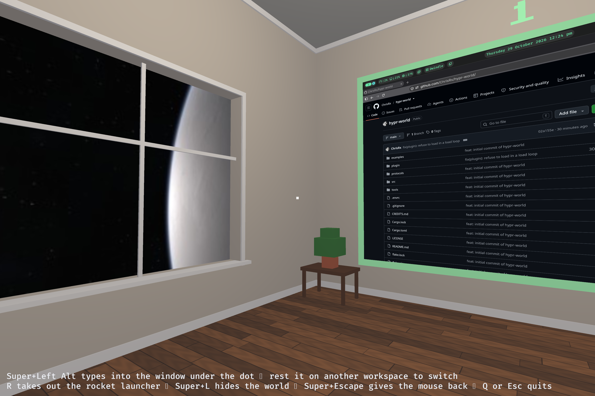

# hypr-world



Every Hyprland workspace on the walls of a 3D house, its windows captured
live and hung where they are in 2D, to walk around in. The app is a Bevy
program running as an ordinary Wayland client. The hypr-world plugin
(`plugin/`) runs inside Hyprland: it feeds the app the desktop, hands it the
keyboard and mouse, and keeps its window in place.

MIT licensed (LICENSE). See [CREDITS.md](CREDITS.md) for where it started
and what it includes.

## Building

The Rust toolchain is rustup's stable (`rust-toolchain.toml`). The flake only
provides the native libraries (Wayland's pkg-config files, Vulkan,
xkbcommon, GBM), loaded automatically by direnv. The ones winit and wgpu
load at runtime go into the app's RUNPATH (the dev shell's `RUSTFLAGS`), so
target/release/hypr-world runs from anywhere, without the dev shell:

```sh
direnv allow                        # once
cargo build --release               # the app
cargo world                         # the app alone, no plugin: see below
plugin/nested.sh backend            # the app against a nested Hyprland's plugin: see below
plugin/dev.sh                       # build the plugin and (re)load it into the session
plugin/dev.sh -k                    # the same, ending the running app first
cargo run --release -- --probe blender   # capture only: sizes and timing
```

`cargo world` (`cargo run --release -- --standalone`) is for working on
the app: it needs no plugin and leaves the session's alone. The desktop
comes from Hyprland's IPC socket, polled 30 times a second, the windows
through capture alone, and the app opens fullscreen and takes the mouse on
a click. There are no layers (the bar), the windows on the walls cannot be
used, and Q or Escape quits. Settings the plugin would pass on can be set
over the control pipe: `echo 'set panorama ~/.config/hypr/panorama.jpg' >
$XDG_RUNTIME_DIR/hypr-world.ctl`.

`plugin/nested.sh backend` is the same with the plugin: it starts a nested
Hyprland drawing on a headless output the size of your monitor, with no
window in the session, loads plugin/'s build into it with a terminal and a
shell, and runs the app here against it (`cargo nested`, `cargo run
--release -- --backend`). The plugin feeds the app as in the session, bar
and shared buffers included, and the app captures from the nested Hyprland.
A click takes the mouse, and while the app has it, its keys, clicks and
scrolls go into the nested Hyprland through a virtual keyboard and pointer,
so Super+Left Alt types into the window under the dot and clicks land on
it. Super+Escape gives the mouse back; there is no flight. `plugin/nested.sh
load` swaps in a new plugin build, and the app reconnects on its own.
`plugin/nested.sh run firefox` opens an app in it, as does Super+Ctrl+Return
for a terminal from inside the world, and `plugin/nested.sh rofi`
(Super+Ctrl+Space inside) opens rofi over the app, starting what it runs in
the nested Hyprland. `plugin/nested.sh headless` sets up the nested side
without the app, and `plugin/nested.sh stop` ends it.

The world key launches target/release/hypr-world itself, its output in
`$XDG_RUNTIME_DIR/hypr-world.log`, written afresh each launch. The plugin
has that path built in (CMake's `HYPR_WORLD_APP`, this tree's
target/release/hypr-world by default, or the `app` package's when
plugin/default.nix is given one), and says so when nothing is there.

The plugin is built against the exact Hyprland the session runs (Hyprland
refuses any other), which `plugin/dev.sh` takes from the nixos-config
(`$NIXOS_CONFIG`, `/etc/nixos/nixos-config` by default). The plugin and the
app speak a line protocol over a unix socket and must come from the same
tree: on a version mismatch the plugin says so and the app exits.

Installed, package.nix builds the app (`nix build`), and plugin/default.nix,
given it as `app` and the session's Hyprland, the plugin that launches it.
The nixos-config builds both and loads the plugin from
`~/.config/hypr/plugins/libhypr-world.so`. `plugin/dev.sh` leaves a plugin
the config loads alone and runs `plugin/nested.sh up` instead, which tries the
build in a nested session (below).

## Using it

With the plugin loaded, the world key (bound to `hl.plugin.hypr_world.toggle`,
`Super+L` in the nixos-config) launches the app if it is not running, shows
it fullscreen on `special:hypr-world` and hands it the keyboard and mouse.
Pressing it again hides it. Every workspace with a window, and the active
one, has a frame on the walls. Resting the crosshair on a window of another
workspace for a quarter second switches to it, so hiding the world lands
there. The line at the bottom lists the keys for the current mode. Without
the plugin the house is empty.

R takes out the rocket launcher while the app has the mouse and keyboard,
and puts it away. While it is out a click fires a rocket from the eyes. One
that hits a window closes it, as Hyprland's own close does, so an app with
unsaved work can still ask. A second hit soon after tells the window's app to
end. One that hits the house only blows up. The plugin keeps clicks from the
windows while the launcher is out.

## Configuration

Everything goes through `hl.plugin.hypr_world.config` in the Hyprland config:

```lua
hl.plugin.hypr_world.config({
  -- The app's own settings, passed on to it as one JSON object.
  world = {
    panorama = "~/.config/hypr/panorama.jpg",
    other_workspace_fps = 15,
  },
})
```

The `world` table. A key below with a dot is a nested table (`room_size =
{ x = 16 }`), and is said with the dot to the control pipe's `set`
(`set room_size.x 16`). A value of the wrong type is the default.

| Key | Default | |
| --- | --- | --- |
| `panorama` | none | Equirectangular image all around the house. `~` is expanded. |
| `msaa` | 2 | Samples a pixel: 1 (or 0) is off, 2, 4 or 8. |
| `frame_size` | 5.04 | The monitor's longer side across a frame, in meters, whatever its resolution and scale. |
| `room_size.x`, `.y`, `.z` | 0 | The least inside size of the room, in meters. The house grows past it to fit the frames. |
| `player.flying` | false | Fly instead of walking. |
| `player.move_speed` | 4.0 | Meters a second. |
| `player.move_inertia` | 0.05 | Easing of movement. |
| `player.look_sensitivity` | 0.0025 | Mouse look speed. |
| `player.look_inertia` | 0.03 | Easing of the look. |
| `player.collision` | true | Collide with the house. |
| `player.walk_bob` | true | Bob the view while walking. |
| `stats` | true | Log frame and capture stats. |
| `sound` | none | A sound played on the way in and out. |
| `other_workspace_fps` | 15 | Frame cap for windows on workspaces other than the one underneath the app, 0 for none. |
| `force_close_within` | 5 | Seconds within which a second rocket on a window that is still there tells its app to end, 0 never. |

`sound` is a file of your own, never part of the repo.

## Models

The app's models are glTF files in `src/models/`, embedded in the binary,
each exported from the `.blend` beside it:

- `launcher.glb`, the rocket launcher in view. Its origin is the middle of
  the launcher. The app scales it so that 1 m along its forward axis spans
  from the launcher's back end to its muzzle on screen (`held` in
  src/launcher.rs).
- `rocket.glb`, a rocket in flight: a capsule 0.25 m long and 7 cm across,
  unlit orange. Its origin is its center, and the app moves it by that.

In both, Blender's +Y is forward (the launcher's muzzle end, the way a
rocket flies) and +Z is up. The exporter turns those into Bevy's -Z and +Y.
Edit a `.blend` in Blender, then export them all and rebuild:

```sh
tools/export-models.sh
cargo build --release
```

## How it works

- Capture works from an ordinary client, including windows on workspaces
  that are not shown (Hyprland renders the window itself for the export
  rather than reading back the screen). Those come at about 10 fps, a
  visible window at about 120.
- Frames stay on the GPU. Three linear dmabufs are allocated with GBM on the
  compositor's render node (named by linux-dmabuf feedback), shared with
  Hyprland as capture targets and imported into Bevy's Vulkan device through
  wgpu-hal. Each new frame is one GPU copy into the texture the quad samples.
  Hyprland sends `ready` after its render finished, so no fences are needed.
  The buffers are allocated with an explicit LINEAR modifier: a plain
  `gbm_bo_create(LINEAR)` reports `DRM_FORMAT_MOD_INVALID` on radeonsi, and
  Vulkan cannot import a dmabuf without a real modifier.
- The plugin hands the app windows' own buffers instead (dmabufs, shared
  memory and single-pixel buffers, including subsurfaces and popups), and
  paces their frame callbacks at the rate the app asks for. A window with a
  buffer the app cannot take stays on capture.
- Capture needs dmabufs. With no render node or no GBM the app says so once
  and captures nothing; a window the compositor offers no usable dmabuf for,
  or whose buffers GBM cannot allocate, is said once and gets no frames.
- Each copy makes Hyprland redraw the window's monitor at once (the export
  protocol's `ignore_damage`) rather than wait for its next frame, which
  comes only when something on it changes.

## Driving it with no hands

`tools/drive.sh [out-dir [steps-file]]` opens the app as the world key does,
takes it round a tour (or the steps in a file: `hold`, `turn`, `wait`,
`set`, `toggle`, `click`, `shot`, described at the top of the script), and
quits. Screenshots of what the app draws, a copy of its log with the stats,
and the GPU's busy percentage four times a second land in the output folder,
`$XDG_RUNTIME_DIR/hypr-world-drive` by default. The same steps put the camera
in the same place each time, so two builds can be compared view for view.

The keys and moves go in through the app's control pipe,
`$XDG_RUNTIME_DIR/hypr-world.ctl` (src/glue.rs `control`). It takes the
plugin's input lines (`key <evdev code> 0|1`, `motion <dx> <dy> <dx> <dy>`,
`button <code> 0|1`) as if the plugin had sent them, `set <dotted.key>
<value>` to change one setting until the plugin next sends them all, and
`screenshot <path>` and `quit`. While a drive runs, the app has the
screen, the keyboard and the mouse. Super+Escape, or `hyprctl hypr-world off`,
takes them back.

## A nested session

`plugin/nested.sh up` is the short way in: it starts the nested session, or
loads the new build into the running one, then brings it and the world into
view. `plugin/dev.sh` runs it for you when the session config loads the plugin.

`plugin/nested.sh start` runs a Hyprland of its own in a window, on the
special workspace `hypr-world-nested` (`plugin/nested.sh show` brings it
into view), with plugin/'s build loaded into it and nowhere else, and a
terminal for the house's walls. A plugin build that crashes takes that
window down, not the session. `plugin/nested.sh load` builds plugin/ again
(`plugin/dev.sh build`) and loads it there in place of the last,
`plugin/nested.sh toggle` is its world key, as is Super+Ctrl+L inside it,
which launches target/release/hypr-world as the session's does,
`plugin/nested.sh drive
[out-dir [steps-file]]` is tools/drive.sh against its app, `plugin/nested.sh
status` says what is running, and `plugin/nested.sh stop` ends it and
everything in it. The nested Hyprland draws only while its window is in view
(a hidden window gets no frame callbacks), so `drive` brings it into view and
puts it back as it found it.

Its config is plugin/nested/hyprland.lua, not the session's. `hyprctl -i <its
instance> hypr-world` says how many windows the plugin shares and how many
buffers it holds. The session's compositor only starts it and shows it:
nothing is loaded into the session. The app inside keeps its pipe and log
in `$XDG_RUNTIME_DIR/hypr-world-nested` (`HYPR_WORLD_DIR`, which the plugin's
launch, the app and tools/drive.sh honor), so both can run at once, and
tools/drive.sh's hyprctl follows `HYPRLAND_INSTANCE_SIGNATURE`.

Hyprland 0.56 points the session's systemd and D-Bus activation environment
at itself when it starts, and takes the same variables out of it when it
exits, `HYPRLAND_NO_SD_VARS` or not. So the nested one runs with stand-ins
for `systemctl` (every `--user` call swallowed) and
`dbus-update-activation-environment` (a no-op) first on its PATH, on a D-Bus
of its own (`dbus-run-session`). Both bit the session before they were in
place: check `systemctl --user show-environment` after trying a change to
how the nested one starts or stops.

### The test client

`plugin/nested.sh client [args]` builds and starts examples/surfaces.rs in it,
floating on its active workspace, its output in
`$XDG_RUNTIME_DIR/hypr-world-nested/surfaces.log`: a window of a known tree
of surfaces for the plugin to share. A toplevel in four colors, a subsurface
above it with a clear left half, and a popup with a half-alpha band that
reaches 100 px past the toplevel's right and bottom edges, open for 3 s and
closed for 3 s in turn (`--popup <seconds>`, 0 to keep it open). Each surface
moves a bar one step a frame callback, so the app's stats show the rate each
draws at, unless `--still`.

| Flag | |
| --- | --- |
| `--below` | Adds a subsurface below the toplevel's own, seen through a clear hole in it, shown while the popup is open. |
| `--crop` | Shows the upper subsurface through a viewport source crop of a buffer twice its size, red outside the crop. |
| `--shm <parts>` | Shared memory (wl_shm) instead of a linear dmabuf for those parts (`main`, `above`, `below`, `popup`, comma-separated). |
| `--same` | Draws every frame the same, for screenshots of surfaces in shared memory, which the plugin takes only as they commit. |
| `--pixel <parts>` | Draws those parts as one pixel each (wp_single_pixel_buffer_v1) stretched by a viewport. |
| `--yuv <parts>` | Draws those parts as linear NV12 dmabufs, eight color bars at 75% in BT.601 limited range. |
| `--one-buffer` | Draws each part into one buffer only, waiting for its release. |
| `--stubborn` | Stays open when asked to close, for trying the launcher's second shot. |

## Looking inside

Built with `cargo build --release --features remote`, the app serves its
Bevy world over Bevy's remote protocol, JSON-RPC on `127.0.0.1:15702`: what
it holds, read and written live while it runs. The world key runs whichever
build is in `target/release`, so build again without the feature to go back.

The desktop as the app has it, the player and the camera are reflected:
`DesktopWindow`, `Workspace` and `DesktopLayer` entities, the `Desktop`
resource, `Player`, `FlyCamera`, and the `WorldState` and `InputMode` states,
besides Bevy's own components, `Transform` and the rest.

```sh
brp() {
    curl -s -X POST http://127.0.0.1:15702 -H 'content-type: application/json' \
        -d "{\"jsonrpc\":\"2.0\",\"id\":1,\"method\":\"$1\",\"params\":${2:-null}}"
}
brp world.list_resources | jq -r '.result[]' | grep hypr_world
brp world.query '{"data":{"components":["hypr_world::windows::DesktopWindow"]}}' | jq '.result'
brp world.get_resources \
    '{"resource":"bevy_state::state::resources::State<hypr_world::flight::WorldState>"}' | jq '.result.value'
```
